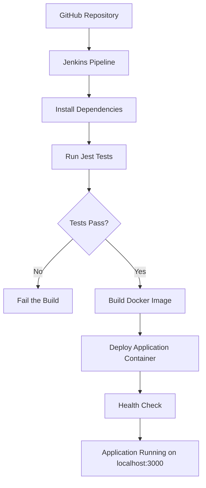

# Node.js CI/CD Pipeline with Jenkins and Docker

A hands-on project demonstrating **Continuous Integration (CI) and Continuous Deployment (CD)** using Jenkins, Node.js, Express, Jest, and Docker.

The pipeline automatically tests the application, builds a Docker image, deploys the application container, and verifies its health whenever a Jenkins build is triggered.

The project runs locally on macOS using Docker Desktop, so you can practise CI/CD without provisioning AWS infrastructure.

## Table of Contents

- [Overview](#overview)
- [Architecture](#architecture)
- [Technology Stack](#technology-stack)
- [Project Structure](#project-structure)
- [Prerequisites](#prerequisites)
- [Getting Started](#getting-started)
- [Configure Jenkins](#configure-jenkins)
- [Run the CI/CD Pipeline](#run-the-cicd-pipeline)
- [Verify the Deployment](#verify-the-deployment)
- [How the Pipeline Works](#how-the-pipeline-works)
- [Troubleshooting](#troubleshooting)
- [Security Notes](#security-notes)
- [Future Improvements](#future-improvements)

## Overview

This project demonstrates how to automate the process of testing and deploying a Node.js REST API.

The Jenkins pipeline performs the following operations:

1. Checks out the source code from GitHub.
2. Verifies the Node.js, npm, and Docker environments.
3. Installs dependencies using `npm ci`.
4. Runs automated tests using Jest.
5. Builds a versioned Docker image.
6. Deploys the application in a Docker container.
7. Checks the application's health endpoint.

The application is exposed locally at `http://localhost:3000`.

## Architecture



Jenkins runs inside Docker Desktop. Its Docker CLI communicates with the Docker engine through the mounted Docker socket, allowing the pipeline to build and manage application containers.

**Current trigger:** Builds are started manually using Jenkins **Build Now**. Automatic GitHub webhook triggering is not configured yet.

## Technology Stack

| Technology | Purpose |
|---|---|
| Node.js 22 | JavaScript runtime |
| Express.js | REST API framework |
| Jest | Automated testing |
| Supertest | HTTP endpoint testing |
| Jenkins | CI/CD pipeline orchestration |
| Docker | Application containerization |
| Docker Desktop | Local container runtime |
| Git and GitHub | Version control and source management |

## Project Structure

```text
jenkins-ci-cd-demo/
├── app.js                 # Express application
├── tests/
│   └── app.test.js        # Automated tests
├── Dockerfile             # Application image definition
├── Jenkinsfile            # CI/CD pipeline
├── package.json           # Dependencies and npm scripts
├── package-lock.json      # Dependency lock file
├── .gitignore
└── README.md
```

A separate `jenkins-docker` directory contains the custom Dockerfile used to build the Jenkins image with Node.js and the Docker CLI.

## Prerequisites

Install the following tools on your Mac:

- [Git](https://git-scm.com/downloads)
- [Docker Desktop](https://www.docker.com/products/docker-desktop/)
- A GitHub account

Node.js and npm are required for running tests locally, but they are not required on the host for the Jenkins pipeline because they are installed in the custom Jenkins image.

Verify Docker Desktop is running:

```bash
docker version
```

Both the Client and Server sections should be present.

## Getting Started

### 1. Clone the repository

```bash
git clone https://github.com/Dazzler123/jenkins-ci-cd-demo.git
cd jenkins-ci-cd-demo
```

### 2. Build the application Docker image

```bash
docker build -t jenkins-ci-cd-demo:local .
```

This command packages the Express application and its production dependencies into a Docker image.

Optionally, run it directly to test the application independently of Jenkins:

```bash
docker run -d \
  --name jenkins-ci-cd-demo-local \
  -p 127.0.0.1:3000:3000 \
  jenkins-ci-cd-demo:local
```

Open `http://localhost:3000/health` to verify it responds.

Clean up this optional test container before running the Jenkins pipeline, because both use port `3000`:

```bash
docker rm -f jenkins-ci-cd-demo-local
```

### 3. Build the custom Jenkins image

The custom image includes Java from the official Jenkins image, Node.js 22, npm, and the Docker CLI.

Create a separate directory:

```bash
mkdir -p ~/Documents/Projects/jenkins-docker
cd ~/Documents/Projects/jenkins-docker
```

Create a file named `Dockerfile` with the following content:

```dockerfile
FROM jenkins/jenkins:lts-jdk21

USER root

RUN apt-get update \
    && apt-get install -y --no-install-recommends \
       curl ca-certificates gnupg \
    && curl -fsSL https://deb.nodesource.com/setup_22.x \
       -o /tmp/nodesource_setup.sh \
    && bash /tmp/nodesource_setup.sh \
    && apt-get install -y --no-install-recommends nodejs \
    && rm -f /tmp/nodesource_setup.sh \
    && rm -rf /var/lib/apt/lists/*

RUN install -m 0755 -d /etc/apt/keyrings \
    && curl -fsSL https://download.docker.com/linux/debian/gpg \
       -o /etc/apt/keyrings/docker.asc \
    && chmod a+r /etc/apt/keyrings/docker.asc \
    && . /etc/os-release \
    && echo "deb [arch=$(dpkg --print-architecture) signed-by=/etc/apt/keyrings/docker.asc] https://download.docker.com/linux/debian ${VERSION_CODENAME} stable" \
       > /etc/apt/sources.list.d/docker.list \
    && apt-get update \
    && apt-get install -y --no-install-recommends docker-ce-cli \
    && rm -rf /var/lib/apt/lists/* \
    && node --version \
    && npm --version \
    && docker --version

USER jenkins
```

Build the image:

```bash
docker build --no-cache -t jenkins-nodejs:lts .
```

Verify that the tools are installed:

```bash
docker run --rm --entrypoint sh jenkins-nodejs:lts -lc \
  'node --version && npm --version && docker --version'
```

### 4. Start Jenkins

Create a persistent Docker volume for Jenkins configuration and job data:

```bash
docker volume create jenkins_home
```

Start Jenkins:

```bash
docker run -d \
  --name jenkins \
  --restart unless-stopped \
  --group-add 0 \
  -p 127.0.0.1:8080:8080 \
  -p 127.0.0.1:50000:50000 \
  -v jenkins_home:/var/jenkins_home \
  -v /var/run/docker.sock:/var/run/docker.sock \
  jenkins-nodejs:lts
```

The additional group is used in this local Docker Desktop setup to allow the Jenkins process to access the mounted Docker socket. This is a highly privileged configuration and should not be copied into a production environment.

Wait for Jenkins to start, then retrieve the initial administrator password if required:

```bash
docker exec jenkins \
  cat /var/jenkins_home/secrets/initialAdminPassword
```

Open:

**http://localhost:8080**

Complete the initial setup, install the suggested plugins, and create your administrator account.

If Jenkins has already been configured, use your existing account instead of repeating the initial setup.

## Configure Jenkins

### 1. Create a Pipeline job

1. Open the Jenkins dashboard.
2. Select **New Item**.
3. Enter the name `nodejs-jenkins-ci`.
4. Select **Pipeline** and click **OK**.

### 2. Configure source control

In the job configuration, find the Pipeline section and select:

- **Definition:** Pipeline script from SCM
- **SCM:** Git
- **Repository URL:** `https://github.com/Dazzler123/jenkins-ci-cd-demo.git`
- **Branch Specifier:** `*/main`
- **Script Path:** `Jenkinsfile`

Save the configuration.

For a public repository, GitHub credentials are not normally required for checkout. Private repositories require suitable credentials.

### 3. Verify Docker access

Before running the pipeline, confirm that Jenkins can communicate with Docker Desktop:

```bash
docker exec jenkins docker version
```

The output should include both the Docker Client and Server sections.

You can also list containers from inside Jenkins:

```bash
docker exec jenkins docker ps
```

## Run the CI/CD Pipeline

1. Open the `nodejs-jenkins-ci` job.
2. Click **Build Now**.
3. Select the running build number.
4. Open **Console Output**.
5. Wait for all stages to complete.

A successful pipeline should finish with:

```text
Finished: SUCCESS
```

The pipeline runs tests before building and deploying the application. If the tests fail, subsequent stages should not run.

## Verify the Deployment

After a successful Jenkins build, open the following endpoints.

| Endpoint | Description |
|---|---|
| [http://localhost:3000/](http://localhost:3000/) | Application welcome response |
| [http://localhost:3000/health](http://localhost:3000/health) | Application health status |
| [http://localhost:3000/api/info](http://localhost:3000/api/info) | Application information |

The health endpoint should return:

```json
{
  "status": "UP"
}
```

Check the deployed container from your Mac Terminal:

```bash
docker ps
```

View the application's logs:

```bash
docker logs jenkins-ci-cd-demo
```

Inspect the generated images:

```bash
docker images jenkins-ci-cd-demo
```

The Jenkins build number is used as the image tag and as the application's `APP_VERSION`.

## How the Pipeline Works

The `Jenkinsfile` defines these stages:

| Stage | Responsibility |
|---|---|
| Checkout | Retrieve the source code from GitHub |
| Verify Environment | Confirm Node.js, npm, and Docker are available |
| Install Dependencies | Run `npm ci` |
| Run Tests | Execute the Jest test suite |
| Build Docker Image | Build a versioned application image |
| Deploy Application | Replace the existing application container |
| Health Check | Verify that the deployed application reports `UP` |

### Continuous Integration

CI checks that the source code can be checked out, dependencies can be installed, and the automated tests pass.

### Continuous Deployment

CD packages the application into a Docker image and runs the new image as a container. The health-check stage verifies that the application starts successfully.

This is a learning implementation, not a zero-downtime deployment strategy. The current deployment removes the existing container before starting and validating the replacement, so a failed deployment may leave the application unavailable until it is fixed.

## Troubleshooting

### Jenkins cannot access Docker

Check the Docker CLI and socket:

```bash
docker exec jenkins docker version
docker exec jenkins ls -ln /var/run/docker.sock
```

A permission error indicates that Jenkins cannot access the mounted socket. Avoid blindly changing the socket to world-writable permissions.

### Jenkins reports `node: not found` or `docker: not found`

Verify the custom image:

```bash
docker run --rm --entrypoint sh jenkins-nodejs:lts -lc \
  'node --version && npm --version && docker --version'
```

If the image is outdated, rebuild it and recreate the Jenkins container while preserving the `jenkins_home` volume.

### Port 3000 is already in use

Find containers publishing the port:

```bash
docker ps
```

Remove only the conflicting test container or stop the service occupying port `3000`. Do not remove unrelated containers without checking which project they belong to.

### Pipeline fails during dependency installation

Ensure `package.json` and `package-lock.json` are committed and synchronized.

Run locally:

```bash
npm ci
npm test
```

### Application health check fails

Inspect the container:

```bash
docker ps -a
docker logs jenkins-ci-cd-demo
```

Confirm that the application starts successfully and that the `/health` endpoint returns the expected response.

## Security Notes

- Jenkins is bound to `127.0.0.1`, so its web interface is intended for local access.
- Mounting `/var/run/docker.sock` grants Jenkins substantial control over the Docker engine and containers on the host.
- The `--group-add 0` configuration is specific to this local learning setup and increases the privileges available to Jenkins.
- Run only trusted Jenkins pipeline code.
- Do not commit passwords, access tokens, private keys, or other secrets.
- Do not expose Jenkins or its Docker socket to untrusted networks.
- For production environments, use an appropriately isolated build agent and a deliberate container deployment security model.

## Future Improvements

Potential next steps for this project:

- Configure a GitHub webhook for automatic pipeline triggers.
- Use Docker Compose to manage the local environment.
- Add deployment rollback and safer replacement strategies.
- Publish versioned Docker images to a container registry.
- Add pipeline notifications and test reports.
- Add image vulnerability scanning.
- Deploy the application to a cloud environment with explicit budget and resource controls.

## Learning Outcomes

By completing this project, you practise:

- CI/CD fundamentals
- Jenkins Pipeline as Code
- Automated testing with Jest
- Docker image creation and container management
- Deployment verification and health checks
- Git-based source control workflows
- Basic deployment security considerations

---

**Repository:** [Dazzler123/jenkins-ci-cd-demo](https://github.com/Dazzler123/jenkins-ci-cd-demo)

**Application:** Node.js + Express REST API

**CI/CD:** Jenkins + Docker

**Environment:** Local macOS development using Docker Desktop
